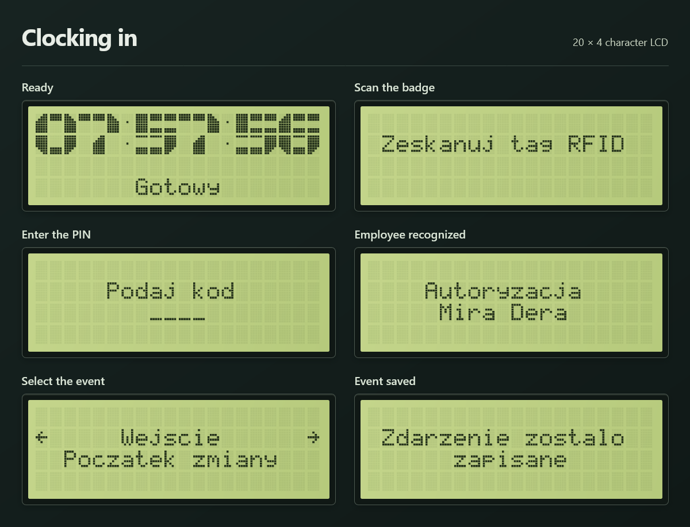
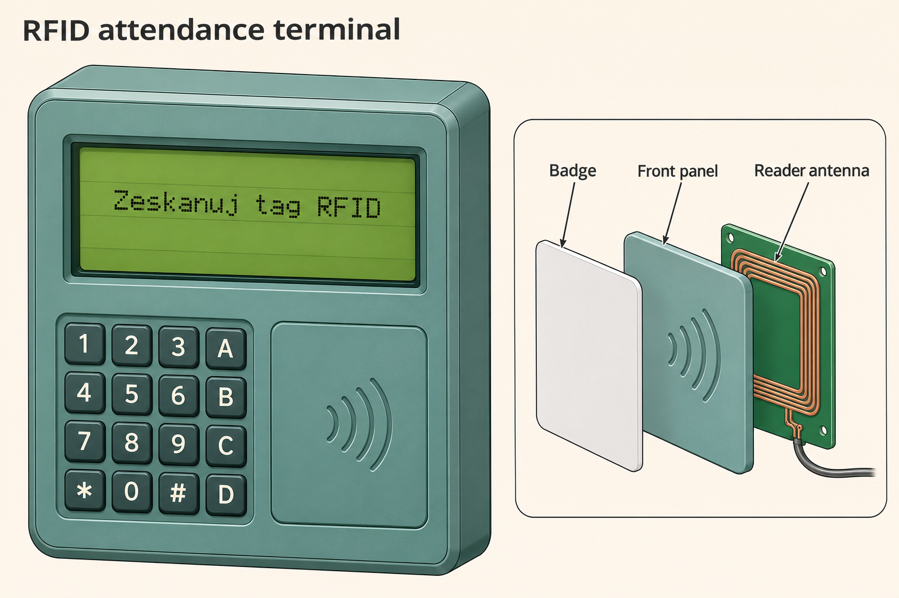
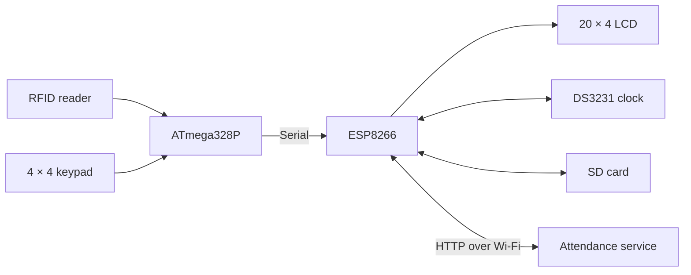
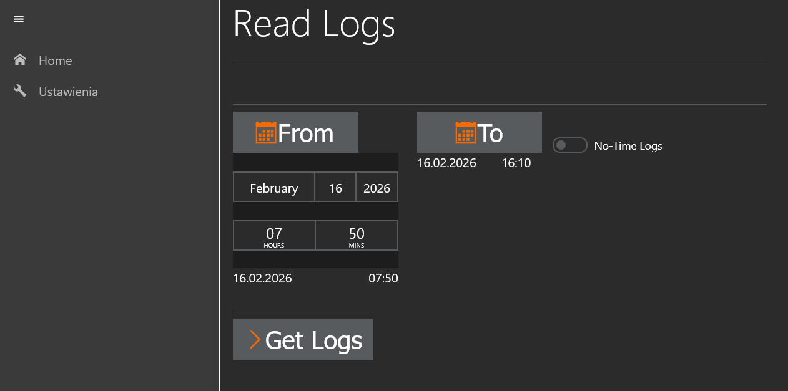

# RFID Attendance Terminal

A two-controller time clock for recording employee arrivals and departures. An ATmega328P reads the badge and keypad. An ESP8266 checks the employee’s access schedule, guides them on a 20 × 4 character display, and saves their selection to an SD card. The terminal can record a shift while Wi-Fi is unavailable and upload the events when the attendance service is reachable again.

[Interface gallery](docs/interface.md) · [Hardware photos](docs/hardware.md#hardware-photos) · [ESP8266 sketch](Test_MainController145617/Test_MainController145617.ino) · [ATmega328P sketch](Test_MainController2/Test_MainController2.ino)

*The display guides the employee from badge scan to confirmation using the firmware’s Polish prompts, clock glyphs and event menu.*

*The badge target on the front panel lines up with the reader antenna behind the plastic face.* [Front panel and controller connections](docs/hardware.md)

## Recording a shift

1. The terminal identifies the employee by badge, four-digit PIN, or both, according to its configuration.
2. It checks the employee’s permitted weekdays and hours against the local clock. A successful match brings up the employee’s name and the available event types.
3. The employee uses **4** and **6** to browse, **A** to confirm, or **C** to cancel. On confirmation, the terminal writes the event to SD and displays `Zdarzenie zostalo zapisane` (“Event saved”).

The table shows the clock-in and clock-out records for employee **17** (Mira Dera) on Monday, 16 February 2026. The LCD shows local time. The event table stores a Unix timestamp along with the employee and event-type IDs.

| Local time (UTC+01:00) | Event selected | Local event ID | Timestamp sent on sync |
| --- | --- | ---: | ---: |
| 07:58 | `Wejscie` · Clock in | 51 | `1771225080` |
| 16:04 | `Wyjscie` · Clock out | 52 | `1771254240` |

The two records and their event labels are available as [shift records](docs/shift-records.json).

## Hardware and data flow

The two controllers divide the work at the serial link. The ATmega328P sends input events. The ESP8266 owns the employee workflow, the display, the clock and the four SD tables for terminal settings, employees, event types and recorded events.

The clock task reads network time and applies the configured time-zone offset to the display and the DS3231. When network time is unavailable, it can recover the time from the RTC if the clock has retained power. The event writer subtracts the offset before storing a timestamp. [Clock task](libraries/TaskUpdateRTC/TaskUpdateRTC.cpp) · [Event writer](libraries/EmployeeManager/EmployeeManager.cpp)

## Synchronization

The ESP8266 pulls terminal settings, employees and event types from the attendance service. In the opposite direction, it reads up to ten saved events at a time and sends each event’s timestamp, employee ID and event-type ID. It removes the corresponding local rows after the server acknowledges the batch. [Synchronization code](libraries/TaskSync/TaskSync.cpp) · [SD table definitions](libraries/DataStore/DataStore.h)

## Web diagnostics

The device also has a browser interface for selecting a diagnostic log interval. This desktop capture opens the **From** date and time controls for this shift. The gallery shows the same filter at phone width. [Desktop and mobile views](docs/interface.md#web-diagnostics)

## Source guide

| Area | Where to start |
| --- | --- |
| ESP8266 startup and peripheral initialization | [Main controller](libraries/MainController145617/MainController145617.cpp) |
| ATmega328P startup, keypad and RFID reader setup | [Input controller](libraries/MainController2/MainController2.cpp) |
| Badge and PIN flow, access hours, and event selection | [Employee manager](libraries/EmployeeManager/EmployeeManager.cpp) |
| LCD layout and custom clock characters | [Display driver](libraries/Display145617/Display145617.cpp) |
| Embedded HTTP server and original browser assets | [Web server](libraries/WebServer145617) |
| Sketches for exercising individual components | [LCD sketch](Test_Display145617/Test_Display145617.ino) · [Sync sketch](Test_TaskSync/Test_TaskSync.ino) |

The firmware references shared Arduino libraries for input, scheduling and storage, and communicates with a separate attendance service. Those components are external to this repository.
