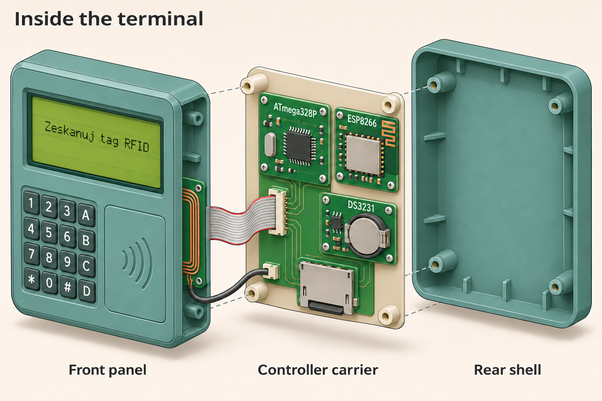

# Terminal hardware

The ATmega328P reads badges and keys. The ESP8266 handles the display, clock and event storage. The enclosure drawings show how these parts can fit into a wall-mounted terminal with a removable back. [Project overview](../README.md) · [Interface gallery](interface.md)

## Front panel

When the display reads `Zeskanuj tag RFID`, the employee presents a badge to the marked area to the right of the keypad. The detail shows the antenna directly behind that area, parallel to the front. In the event menu, **4** and **6** move between entries, **A** saves the selection and **C** cancels. [Employee workflow](../libraries/EmployeeManager/EmployeeManager.cpp) · [LCD sequence](interface.md#terminal-display)

## Inside the enclosure

The reader stays with the front panel as the enclosure opens. The keypad ribbon runs to a carrier that holds the ATmega328P, ESP8266, DS3231 clock and SD socket. The rear shell supports the carrier on four corner bosses. With the shell open, the card slides out at the lower edge while the display and keypad stay in place.

## Controller connections

Two peripherals use SPI on separate processors. The ATmega328P selects the reader with **D9**. The ESP8266 selects the SD card with **GPIO16**. The arrow shows badge and keypad events travelling from the input controller to the ESP8266.

| Controller | Peripheral | Signals in the firmware |
| --- | --- | --- |
| ATmega328P | Matrix keypad | Group lines `A5`, `A4`, `A3`, `A2`. Sense lines `D4`, `D5`, `D6`, `D7`. |
| ATmega328P | RFID reader | SPI with chip select on `D9` and reset on `D8`. |
| ESP8266 | 20 × 4 character LCD | I²C address `0x3F`. |
| ESP8266 | DS3231 clock | I²C. The firmware can recover local time from the clock when network time is unavailable and the RTC has retained power. |
| ESP8266 | SD card | SPI with chip select on `GPIO16`. |

[Keypad and reader configuration](../libraries/MainController2/MainController2.cpp) · [LCD initialization](../libraries/Display145617/Display145617.cpp) · [SD and RTC initialization](../libraries/MainController145617/MainController145617.cpp) · [Clock update and recovery](../libraries/TaskUpdateRTC/TaskUpdateRTC.cpp)
