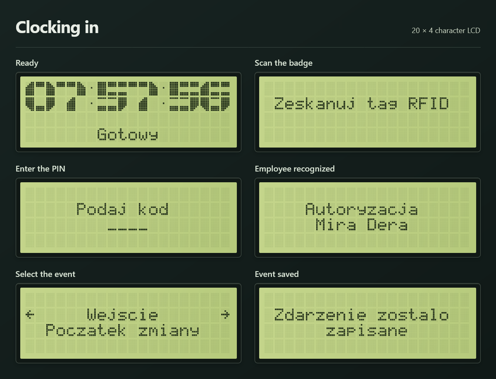
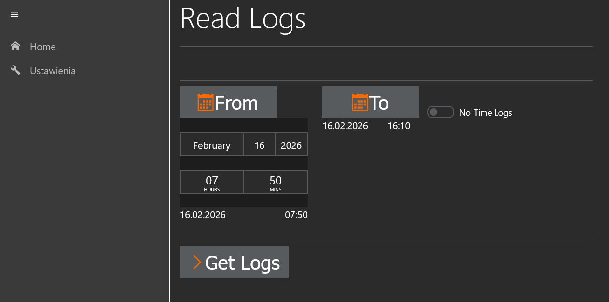
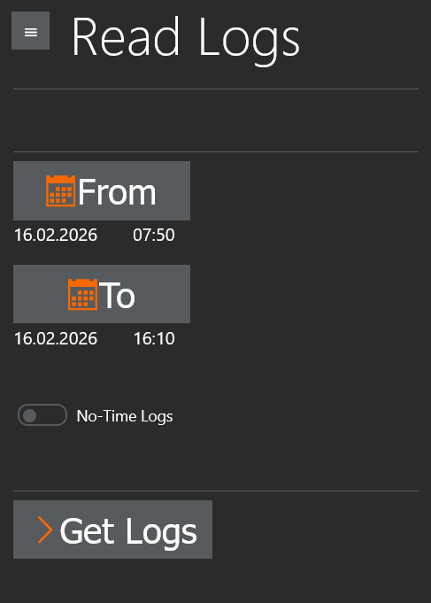

# Interface gallery

The character display guides an employee through a clock-in. The browser panel lets an operator select an interval for device diagnostics. Both views cover the same shift on Monday, 16 February 2026. [Shift records](shift-records.json) · [Project overview](../README.md)

## Terminal display

The firmware arranges each screen in 20 columns and four rows. The large clock uses custom character bitmaps. The centered messages, menu arrows and original Polish prompts follow the display and employee-management code. [Display driver](../libraries/Display145617/Display145617.cpp) · [Employee workflow](../libraries/EmployeeManager/EmployeeManager.cpp)

| Display | What the employee sees or does |
| --- | --- |
| `Gotowy` | The terminal is ready. The large digits show local time. |
| `Zeskanuj tag RFID` | Present the badge to the reader. |
| `Podaj kod` | Enter the four-digit PIN. The four underscores show the empty input. |
| `Autoryzacja` / `Mira Dera` | The employee has been recognized and is within the permitted access period. |
| `Wejscie` / `Poczatek zmiany` | Select the configured “Start of shift” event and press **A**. |
| `Zdarzenie zostalo` / `zapisane` | The event has been written to local storage. |

The shift records show a clock-in at **07:58** and a clock-out at **16:04**, local time (UTC+01:00). The event names and captions come from the configured event types. A terminal can receive different labels during synchronization.

## Web diagnostics

The following browser captures render the project’s HTML, Metro UI styles, JavaScript and icon font. The **Read Logs** filter spans **07:50** to **16:10**. The original shell also links to Home and Settings. Their page bodies and the diagnostic log client are external to the source snapshot. [Web shell](../libraries/WebServer145617/Assets/index.html) · [Log filter markup](../libraries/WebServer145617/Assets/ReadLogsBody.html)

### Desktop

Opening **From** reveals the date and time selectors. **To** shows the end of the interval. The **No-Time Logs** switch is off so the selected times apply.

### Mobile

At phone width the two date buttons stack vertically. The chosen dates and times stay visible below the buttons, and **Get Logs** follows the switch.

